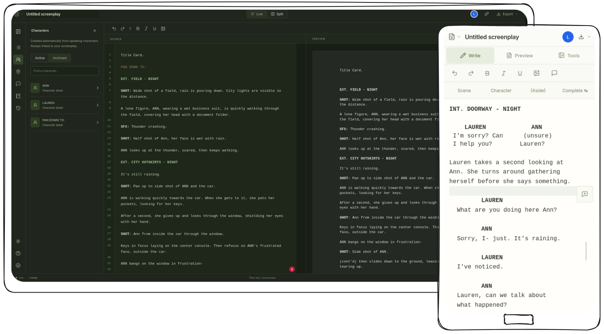

# Screenwriter

Basic self-hosted collaborative [Fountain](https://fountain.io/syntax/) screenplay editor.

Built with: Vue 3, CodeMirror 6, Yjs, Node 24 and SQLite.



## Features

- **No in-app AI Features**
- Desktop and mobile-friendly, with touch and keyboard shortcuts.
- Real-Time collaboration
- Basic Versioning
- Full Fountain syntax support, including dual dialogue, notes, and comments.
- Character and Location sheets
- Commenting and Suggestions
- Reference Images in text or on character/location sheets.
- Split editor with synchronized scrolling or WYSIWYG preview.
- Easy setup (Single container)
- Optional OAuth authentication with OpenID Connect.
- Some screenplay niceties like autocomplete.
- Export to PDF or Fountain text file.

## Run

> [!IMPORTANT]
> Screenwriter *should* keep your data safe, but I made this in like 4 hours late at night, so please back up your data by exporting to Fountain occasionally. If you find a bug, please report it in [Issues](https://github.com/AnnikenYT/screenwriter/issues).

```sh
docker run -d --name screenwriter \
  -p 3000:3000 \
  -v screenplay-data:/data \
  -e PUBLIC_URL=https://screenwriter.yourdomain.com \
  ghcr.io/annikenyt/screenwriter:latest
```

`PUBLIC_URL` must be set to the exact browser-facing origin, including scheme and port. Screenwriter was initially meant to only run behind an authenticating reverse proxy, so by default it has no authentication. See **Authentication** below for optional OAuth.

For all other configuration options, see [`.env.example`](.env.example).

## Authentication

- **`AUTH_MODE=none`** (default): everyone who can reach the server can access the **shared workspace**.
  - Click your avatar to choose a writer name.
- **`AUTH_MODE=oauth`**: sign in through an OpenID Connect provider.
  - Set `PUBLIC_URL`, `OIDC_ISSUER`, `OIDC_CLIENT_ID`, and `OIDC_CLIENT_SECRET`.
  - Register callback: `${PUBLIC_URL}/auth/callback`.
  - Optional restriction: `OIDC_ALLOWED_EMAIL_DOMAINS=example.com`.
  - **Using OAUTH enables Personal Workspaces**:
    - Each user has a private workspace, and can share documents with others.
    - Sharing can be done by email or by generating a shareable link.
    - Account-free links can be reopened in a fresh browser session by anyone holding the link.

### Existing documents

- Back up the data first. Old OAuth sessions must sign in again.
- Legacy documents stay hidden in OAuth mode until assigned an owner.
- List IDs: `AUTH_MODE=oauth DATA_DIR=/data node server/ownership.js --list`.
- Map IDs to emails in `owners.json`: `{"document-id":"owner@example.com"}`.
- Preview: `AUTH_MODE=oauth DATA_DIR=/data node server/ownership.js owners.json`.
- Apply the same command with `--apply`. Owners must sign in with verified emails.
- Changing auth mode does not make private documents public.

## Deployment notes

- You can use the `dev`, `main`, or `<branch-name>` as a tag to get faster updates, while `latest` is always the newest stable release. You can also use `:0.0.0` or `:v0.0.0` to pin a version.

- PDF: Courier is not full-Unicode; no automatic continuation cues; long title metadata is clipped.
- Health check: `/api/health`. Limits and other settings: [`.env.example`](.env.example).

## Development

```sh
npm ci
PUBLIC_URL=http://localhost:5173 npm run dev
```

- Requires Node **24+**; open **http://localhost:5173**.
- Local OAuth: `npm run dev:oauth`, then open **http://127.0.0.1:5173**. Pick Alice, Bob, or a custom email. Use separate browser profiles to test sharing.
- OAuth test data stays in `data/dev-oauth`. Optional overrides: `DEV_OAUTH_DATA_DIR`, `DEV_OAUTH_UI_PORT`, `DEV_OAUTH_API_PORT`, `DEV_OAUTH_ISSUER_PORT`.
- Tests: `npx playwright install chromium`, then `npm run verify`.

## To-Do

- [ ] [Offline support](https://github.com/AnnikenYT/screenwriter/issues/1)
- [ ] [Themes](https://github.com/AnnikenYT/screenwriter/issues/2)
- [x] [Better Access Control/Per-User Workspace](https://github.com/AnnikenYT/screenwriter/issues/3)
 (implemented in dev).

## License

- [MIT](LICENSE).
